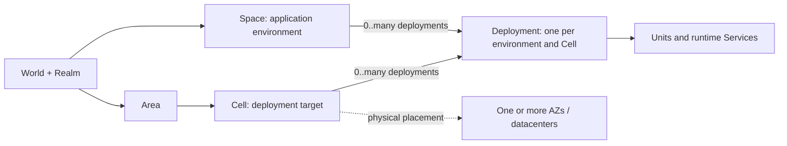

# Infrastructure Ontology

This ontology defines reusable infrastructure identities and their relationships. It defines no new environment variables, role APIs, universal slug allowlists or controller capabilities. Projects own concrete values, syntax, topology and operational exceptions.

## Identity dimensions

Present dimensions in the order **Unit, World, Realm, Space, Area, Cell** when they are needed. Require only dimensions consumed by the operation; a shortened identifier is meaningful only within an explicitly fixed enclosing scope.

| Dimension | Definition |
| --- | --- |
| **Unit** | Component identity, such as an application backend, frontend or infrastructure unit. It is separate from the application environment and deployment target. |
| **World** | Product or system identity. |
| **Realm** | Operational purpose within a World, such as production, collaborative development or individual experimentation. |
| **Space** | Logical application identity and state namespace within World + Realm. |
| **Area** | Infrastructure area within World + Realm containing one or more Cells. |
| **Cell** | Installation or logical deployment target, uniquely identified by World + Realm + Area + Cell. The final Cell value is an opaque installation slug. |

**Service** identifies a runtime service of a Unit, such as an API server or worker. A Unit may expose multiple Services, each with multiple processes or replicas. Neither Unit nor Service substitutes for Space or Cell.

**Availability zone (AZ)** identifies a physical failure domain. It is distinct from Cell identity: a Cell can occupy one AZ, several AZs or multiple datacenters. Provider zone names and actual shared failure risks must be recorded separately from logical placement.

## Relationships and invariants

- The logical application environment identity is **World + Realm + Space**.
- The deployment target identity is **World + Realm + Area + Cell**. A Cell belongs to one Area in that scope; its slug may repeat in another World, Realm or Area.
- Space and Cell are separate dimensions associated through deployment. Multiple Spaces may deploy to the same Cell, and one Space may deploy to multiple Cells within its World + Realm.
- Each application environment has **at most one logical deployment in a given Cell**. A deployment is the association of the environment with the target, identified by **World + Realm + Space + Area + Cell**. Multiple Units, Services, nodes, replicas and successive releases belong to that association; they do not create another independently identified deployment.
- Cell slugs may resemble an AZ, region, provider or purpose, but those spellings do not supply topology or role semantics. Resolve the qualified target and its configuration rather than interpreting the slug.
- Roles are properties of installations, not identity components. Changing master/replica responsibility or membership preserves Cell identity. A distributed installation may be described with the role `cluster`; that term alone establishes no supported command or role API.

The two deployment edges express a many-to-many association between Spaces and Cells, with no duplicate association for the same pair. The diagram is not a containment chain from Space to Area to Cell.

## Recommended slugs and readable names

Use the same canonical slug for the same meaning across projects when introducing or explicitly migrating configuration. Store these slugs in lowercase; uppercase forms such as EDG or HST are display abbreviations, not additional runtime values. The full names below explain the abbreviations. They are not compatibility aliases that parsers must accept. A short slug need not have exactly three characters.

This is an extensible recommendation registry, not a universal allowlist. Existing project values remain valid under their documented contracts. Projects register product identities, tenant names, sites and exceptional values locally, with their full names and intended scope; do not invent a shared alias for every product or provider. Renaming an existing value requires coordinated consumer, resource and recovery review; this document performs no migration.

| Existing identity input | Recommended slug | Full name | Intended meaning |
| --- | --- | --- | --- |
| `OPS_UNIT` | `core` | Core | Main application backend component. |
| `OPS_UNIT` | `web` | Web | Web frontend component. |
| `OPS_UNIT` | `ops` | Operations | Operational tooling component, where independently identified. |
| `OPS_WORLD` | `<product>` | Registered product or system name | Stable project-owned product slug, for example illustrative `atlas` for Atlas; preserve actual registered product identities. |
| `OPS_REALM` | `prd` | Production | Real production operation. |
| `OPS_REALM` | `stg` | Staging | Pre-production acceptance with production-like configuration and, where explicitly permitted, real data. |
| `OPS_REALM` | `dev` | Development | Collaborative development and testing, normally delivered to a centrally reachable, shared environment. |
| `OPS_REALM` | `lab` | Laboratory | Individual experimentation and development, normally local and private to one person. |
| `OPS_SPACE` | `hq` | Headquarters | Main production application environment; not the name of a physical office, Cell or current primary. |
| `OPS_SPACE` | `sbx` | Sandbox | Interactive development and experimentation state, commonly within `lab`. |
| `OPS_SPACE` | `tst` | Test | Dedicated automated-test state and fixtures, commonly within `lab`; not a synonym for the `dev` Realm. |
| `OPS_SPACE` | `qa01`, `qa02`, … | Quality assurance 01, 02, … | Independently identified collaborative QA environments, commonly within `dev`. |
| `OPS_AREA` | `edg` | Edge | User-operated devices: laptops, desktops and workstations. This vocabulary does not mean a public edge proxy or CDN. |
| `OPS_AREA` | `cld` | Cloud | Cloud infrastructure area; projects name and qualify concrete provider or regional areas as needed. |
| `OPS_AREA` | `dc` | Datacenter | Managed datacenter infrastructure area; projects distinguish concrete sites locally. |
| `OPS_CELL` | `hst` | Host | Installation whose application processes execute directly in the host operating system. |
| `OPS_CELL` | `cmp` | Compose | Installation whose application services execute through a container Compose model. |
| `OPS_CELL` | `dkp` | Dokploy | Installation managed through Dokploy; actual hosts, orchestration and physical placement remain project-owned configuration. |
| `OPS_CELL` | `vgt` | Vagrant | Installation in one or more virtual machines managed through Vagrant. |
| `OPS_CELL` | `k8s` | Kubernetes | Kubernetes-based installation, with the actual cluster/namespace boundary explicitly defined by the project. |

For runtime Service identity, existing `OPS_SERVICE` contracts can use the following vocabulary when applicable. This table does not introduce that variable into systems that do not consume it.

| Recommended slug | Full name | Intended meaning |
| --- | --- | --- |
| `api` | Application programming interface | Runtime API service of a Unit. |
| `web` | Web | Runtime web-serving service of a Unit. |
| `worker` | Worker | Background processing service of a Unit. |
| `server` | Server | Generic server service where a more specific service identity is unnecessary or the project already uses this value. |

Unit `web` and Service `web` belong to different dimensions. Service names, availability-zone identifiers, release/build/launch metadata, image references and addresses retain their owning contracts; the six identity inputs do not imply a universal abbreviation scheme for every environment variable. Keep provider-defined AZ identifiers intact rather than replacing them with Cell slugs.

### Development and laboratory purposes

`dev` describes collaboration: multiple people interact with shared application environments, often published centrally as several QA Spaces. `lab` describes one person's local work, typically using native processes, Docker Compose or local virtual machines, without publication as a shared team environment. Local startup still creates the logical deployment association defined above; it is distinct from publishing an environment for collaborators.

For local individual development across projects, use Realm `lab`, Area `edg`, Space `sbx` for interactive sandbox work and Space `tst` for automated tests when introducing or explicitly migrating those identities. Keep these meanings consistent across products; choose a distinct Space only for a genuinely different state namespace. These recommendations do not automatically migrate existing projects or require a specific Cell implementation.

Choose Realm by purpose, not by whether Docker, a VM or a remote machine is used. A private remote laboratory can remain `lab`; a deliberately shared development environment can be `dev` even when hosted on someone's workstation. Such exceptions need explicit access and ownership boundaries. `stg` is pre-production acceptance rather than a synonym for collaborative development or automated local tests.

### Placement mnemonics and uniqueness

Recommended Cell slugs are naming mnemonics, not a runtime classifier. Resolve topology from configuration. Supporting dependencies may run in Compose while application processes run natively in Cell `hst`; this does not by itself create another Cell or change the application environment. Conversely, choose `cmp` when the declared installation runs its application services through Compose. Vagrant VM nodes, container replicas and Kubernetes nodes do not automatically become additional Cells.

A bare `hst`, `cmp` or `vgt` is appropriate only when unique within World + Realm + Area. Two independently identified workstations in the same `(atlas, lab, edg)` scope need distinct stable Cell slugs, such as `hst-ws01` and `hst-ws02`; there is no implicit user or hostname identity dimension. Repeating a suggested slug in another World, Realm or Area remains valid. These recommendations neither constrain Cell roles nor require renaming a Cell when its implementation changes.

## State, placement and metadata

Application-owned state remains Space-scoped: databases, buckets, queues and other application namespaces use World + Realm + Space, with Unit or module distinctions where needed. Deployment to another Cell does not silently rename that state. Replication, independent physical copies and shared access require explicit data ownership and routing contracts.

Placement-owned resources use the qualified deployment target where needed, for example host management or infrastructure endpoints. Resources owned by a particular application deployment may need both Space and the qualified Cell target. Project-specific shortened context, lock or history keys must document their fixed scope and collision limits. Each target system owns its separators, escaping and length constraints; the identity tuples do not prescribe string concatenation.

Changing metadata alone neither migrates state nor changes dependency routing. Moving data, switching endpoints, promoting a database and changing public ingress are separately controlled operations with their own verification and authority.

Release versions, build identifiers, image references, deployment execution tags and launch identifiers describe artifacts or executions of a logical deployment. They are not additional environment or target identity dimensions. A new launch or release preserves the deployment association even when its Services or replica counts change.

### Shared dependencies and Space isolation

Share each dependency that supports any suitable form of logical separation as one logical instance per World + Realm, rather than starting one instance for every Space. Evaluate supported databases, schemas, tenants, namespaces, buckets, accounts and other native boundaries before declaring a dependency unshareable. Separate application data using the dependency's appropriate logical boundary: database, schema, tenant, key prefix, namespace, queue or file volume. Shared infrastructure belongs to the Realm; its existence does not require an artificial application Space. With multiple Cells, explicitly document physical members, replication, endpoints and reachability; realm ownership alone does not describe that topology.

A dependency that cannot safely serve multiple Spaces normally belongs to the consuming service’s application deployment, with configuration, startup, shutdown, reset and recovery coordinated by that deployment. It is not another Realm infrastructure stack. Before choosing a deployment-bound instance, an isolation exception, a replacement or removal, explain the unsupported sharing or isolation requirement and get explicit approval from the responsible project decision-maker. Space-specific configuration alone does not establish that a dependency cannot be shared: first evaluate its native logical boundaries.

Runtime role determines ownership. A Temporal server can be Realm-owned infrastructure while a Temporal worker container belongs to the Core service deployment for its Space. Running a process in Docker does not make it shared infrastructure. Tooling ownership and runtime lifecycle are separate: an infrastructure component may own reusable definitions for deployment-bound processes while the consuming application deployment coordinates their lifecycle.

Shared infrastructure names use the World–Realm prefix and omit Space, for example illustrative `atlas-lab-postgres`; deployment-bound process names include Space and the consuming service identity under the project’s naming contract, for example `atlas-lab-sbx-core-worker`. Logical databases can remain `atlas_lab_sbx` and `atlas_lab_tst` regardless of Area or Cell. Names express ownership, not proof of isolation. Shared cluster-level roles or administrative credentials remain dependency/Realm-owned where applicable; application data, authentication state, signing material and files remain Space-owned under their actual contracts. Do not reset shared roles or rotate shared credentials as a side effect of provisioning a Space.

Logical separation must enforce application and API isolation; sharing a process accepts a common failure and maintenance boundary. Validate that each consumer selects its own database/tenant, endpoint and credentials, and that unauthorized cross-Space requests or tokens cannot access another Space's state. A namespace or different port alone is not an authorization boundary. Shared mail or object fixtures must be selected and removed by exact ownership rather than clearing a service globally.

Stopping, cleaning, resetting or recovering one Space must preserve shared dependencies and every other Space's resources. Shared-service maintenance must identify its affected Spaces and coordinate them. Keep Realm and Space configuration, state records, locks and lifecycle operations distinct; a Space operation must not acquire broader data-loss authority merely because it can reach the shared dependency.

Space backup and recovery must include the selected logical database, associated files and required protected configuration in a consistent recovery unit. They must not replace a shared database server's physical data volume as a Space operation. Realm-wide physical recovery is separate and may affect every Space; a Space backup can depend on retained Realm roles, compatible versions and other explicitly recorded prerequisites, so it does not prove whole-Realm recoverability.

Verification should demonstrate simultaneous operation, rejection of unauthorized cross-Space access, exact fixture cleanup, preservation of neighboring Spaces during reset/recovery and persistence across authorized shared-service restarts. Data recreation, reset exceptions, particular products and ports remain project-owned decisions. Adding this ontology or changing metadata authorizes no data deletion, dependency startup, migration or runtime change.

## Illustrative examples

All examples below are illustrative, not claims about deployed state, available targets or implemented tooling. Names illustrate the recommended vocabulary and project choices; they are not reserved values or allowlists.

### Local host with Compose dependencies

World `atlas`, Realm `lab`, Area `edg`, Cell `hst` identify the target `(atlas, lab, edg, hst)`. Spaces `sbx` and `tst` identify two environments `(atlas, lab, sbx)` and `(atlas, lab, tst)` deployed to that same Cell. Each has one logical deployment there, containing Units `core` and `web`; Core's `api` and `worker` Services can each have several processes.

The application runs natively on the workstation while a shared Compose project `atlas-lab` hosts PostgreSQL and other shareable dependencies. Databases `atlas_lab_sbx` and `atlas_lab_tst`, separate file volumes and Space-specific credentials isolate application state. Database-bound API/Auth processes remain in each Space's application lifecycle. This is one Cell with two Spaces, not one infrastructure Cell for each Compose project.

If the application services themselves run through Compose, an installation may instead use Cell `cmp`, with Space projects `atlas-lab-sbx` and `atlas-lab-tst` alongside shared dependencies. Ports and mutable resources must remain isolated. Choosing or changing a metadata slug alone neither starts containers nor migrates state. A separate workstation within the same World, Realm and Area needs a distinct Cell slug such as `hst-ws02`.

### Vagrant

World `atlas`, Realm `lab`, Area `edg`, Cell `vgt` identify one personal VM-based installation. Space `sbx` deploys Core and Web there; VMs named `app01`, `app02` and `dbs01` are nodes of that Cell, not three more deployments. The same Space can also deploy to Cell `hst` in that Area, producing a second deployment association while retaining environment identity `(atlas, lab, sbx)`.

If those placements need independent application state, choose distinct Spaces or explicitly design state isolation; changing only Cell metadata does not create it. A centrally published Vagrant-based environment used by collaborators would use Realm `dev` instead. This example requires no Vagrant implementation or automatic provisioning.

### Single-AZ master and replica Cells

World `atlas`, Realm `prd`, Area `enterprise` contain Cells `east` and `west`. Cell `east` is installed in failure domain `room-a` and has master responsibility; Cell `west` is installed in `room-b` and follows as a replica. Each Cell is single-AZ in this example. Space `hq` deploys to both, with one deployment per Cell and the same application environment identity `(atlas, prd, hq)`.

A promotion can exchange master/replica responsibilities without renaming either Cell or Space. Application dependency routes, store replication, fencing and ingress must be handled explicitly; PostgreSQL replication alone does not replicate every dependency. Additional Spaces may share either Cell while retaining their own state namespaces.

### Distributed multi-AZ Cells

World `atlas`, Realm `prd`, Area `cloud`, Cell `regional` identify one distributed installation with the descriptive role `cluster`. Space `hq` has one logical deployment in that Cell even when Units and Services run across three AZs. Three voters placed one per AZ can use a majority quorum of two in a system designed for that scheme; loss of one AZ leaves two voters. This is an example of voting placement, not a universal database or controller design.

A separate Cell `(atlas, prd, cloud, wide)` could span five AZs or datacenters with five voters, one per failure domain, and a majority quorum of three. Loss of two domains leaves three voters under that scheme. Latency, correlated failures, fencing, storage durability, replication mode and each service's quorum rules still require design and tests; application replica counts need not equal voter counts. Neither example establishes support for a `cluster` role in any existing controller.
